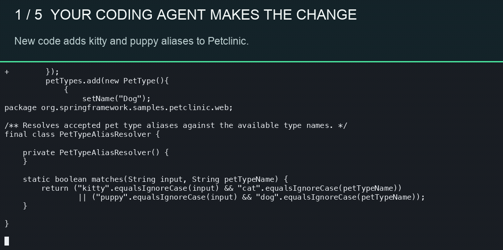

  

<h1 align="center">Verify a code change with executable evidence</h1>

  <strong>Turn a change or reviewer finding into a focused test.</strong> 
  Run the test on both revisions and inspect the evidence.

  
  
  

## Verify a change

Run `verify` inside a Git repository with a committed or uncommitted change:

~~~sh
verify
verify --finding "The retry can charge the same payment twice"
verify check --finding-file reviewer-comment.txt
~~~

Verify detects the repository and base revision, reads the changed files and nearby project context, and asks JAIPilot's managed Claude endpoint for one focused test. It writes the proposed test in isolated Git worktrees and runs the same command on the base and changed revisions. A test that does not build can be revised using its actual execution output, for at most three proposals per run. The command must use an approved project test runner; Verify does not install dependencies or run model-proposed shell pipelines.

The default run does not edit your checkout. After seeing the evidence and generated test diff, you can choose to add that test file. Verify never edits production code in this flow. Source snippets, diffs, reviewer findings, and test output used by the model are sent to the JAIPilot backend and Claude. Test commands execute on your machine in temporary worktrees.

The verdict describes the observed test result: `introduced_regression` means the test passed on the base and failed on your change; `changed_behavior_verified` means the reverse; `no_reproduction_found` means the attempted test passed on both; and `inconclusive` covers failures on both or timeouts. Inspect the test assertion and command before relying on a verdict. Passing one generated test does not establish that the whole change is safe.

Verify uses your JAIPilot sign-in and shared credits for Claude calls. The first run opens browser sign-in if needed. It charges measured model usage, returns credits used, and limits each run to three model proposals. Local test execution consumes no JAIPilot credits. Each run's reports, generated diff, and worktrees remain in a private cache directory for inspection.

Test commands run in worktrees with your local project toolchain; worktrees are not an operating-system sandbox. Run Verify on repositories and toolchains you trust. The model receives only selected changed files, relevant project context, the finding, and bounded test output. It does not receive a repository archive.

## Install

You need Git and your project's normal build and test tools. Verify uses the same JAIPilot browser sign-in as the JAIPilot CLI.

**macOS / Linux**

~~~sh
curl -fsSL https://raw.githubusercontent.com/JAIPilot/verify/main/install.sh | sh
~~~

**Windows (PowerShell)**

~~~powershell
irm https://raw.githubusercontent.com/JAIPilot/verify/main/install.ps1 | iex
~~~

The installers download the latest release for your system and verify its SHA-256 checksum. To build from source instead, use Go 1.26.2 or later: `go build -o dist/verify ./cmd/verify`.

`verify start` checks for a newer GitHub release before verification. If one is available, it verifies and installs the update automatically. That run finishes using the version already in memory; the next run uses the update. On Windows, replacement happens after Verify exits. Use `verify update` to check manually. Previously installed binaries need one installer run to gain the automatic updater.

The earlier local-agent workflow remains available as `verify start`:

~~~sh
verify start
verify start --agent codex
verify start --agent claude --base origin/main
~~~

`verify start` uses a signed-in Codex or Claude Code CLI and that provider's account; it does not consume JAIPilot credits. This earlier, four-stage workflow still:

1. Adds characterization tests on the base revision and replays them on the change.
2. Asks about unclear intent before editing, then shows the complete candidate diff for approval.
3. Adds tests for accepted behavior, runs the full suite, and measures native coverage when available.
4. Lets you decide whether to apply the tested candidate diff to your checkout.

See [the detailed workflow](docs/how-it-works.md) for its evidence and approval rules.

### Spring Petclinic video

  

This recording shows an earlier, multi-stage Verify workflow on Spring Petclinic. It illustrates the baseline, review, and final test sequence; the default `verify` command in v0.2.0 has a different terminal flow. See the [recording notes](assets/demo/README.md) for the exact run and measured results.

Run `verify --help` for the new check options or `verify start --help` for the earlier workflow options.

## What you see

The new check prints the verdict, test path, command, both exit codes, credits used, and report path. The JSON report retains bounded command output and points to the saved generated test diff. Use `verify check --json --non-interactive` for automation.

~~~text
Verify: introduced_regression
The focused test passed on the base and failed on the change.
Test: calc.increment.test.cjs  Command: node --test calc.increment.test.cjs
Base: exit 0  Change: exit 1
Credits: 1  Evidence: <private cache>/jaipilot/verify/<run-id>/report.json
~~~

The exit code reports whether Verify completed. Read the `verdict` field when using it as a CI gate; a completed run can still report a regression or an inconclusive test.

The check is language-neutral. It follows existing test conventions and permits common Go, JavaScript/TypeScript, Python, Java/Kotlin, Rust, .NET, Swift, Ruby, PHP, and C/C++ test file types. Projects whose test command is unavailable or unsupported receive an inconclusive result.

The managed backend and credit migration are maintained in the JAIPilot functions repository. The [earlier local-agent workflow](docs/how-it-works.md) remains available as `verify start`.

[Contributing](CONTRIBUTING.md) · [Report an issue](https://github.com/JAIPilot/verify/issues) · [MIT License](LICENSE)
