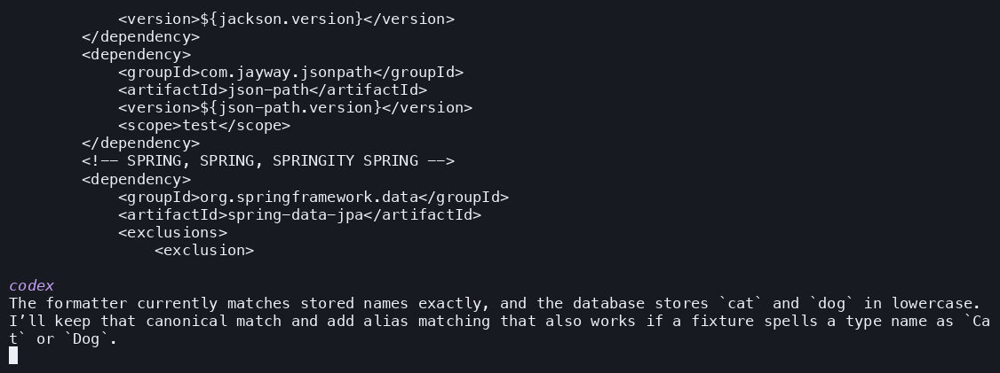
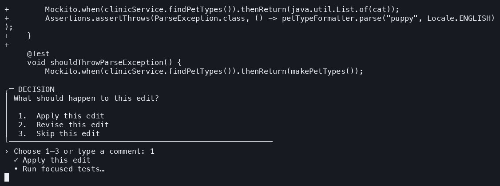

<p align="center">
  
</p>

<h1 align="center">Verify your change before you ship it</h1>

<p align="center">
  <strong>A testing agent that verifies existing behavior as you change code.</strong><br>
  See what your change affected, decide what should happen, and test the result.
</p>

<p align="center">
  <a href="https://github.com/JAIPilot/verify/releases/latest">Download Verify</a> ·
  <a href="#get-started">Get started</a> ·
  <a href="#how-verify-works">How it works</a> ·
  <a href="https://www.jaipilot.com/">JAIPilot.com</a>
</p>

## What Verify does

1. **Make a code change.** Use Codex or any other tool. Verify looks at both new code and existing code you edited.
2. **Check what used to work.** For the existing code you touched, Verify writes tests against the version before your change, then runs those tests on your changed version. You can see which behavior still works and which changed.
3. **Decide what should happen.** Verify asks about unclear behavior and shows proposed code or test edits for your approval.
4. **Test the agreed result.** Verify runs the project tests and coverage checks, reports the outcome, and lets you review the full diff before applying it.

In the Petclinic demo below, Codex adds new pet type aliases. Verify checks that the existing pet names and errors still work, then tests the alias behavior we accept.

## Watch a real run: Codex → Verify → `good_to_go`

We recorded this on a local checkout of [Spring Framework Petclinic](https://github.com/spring-petclinic/spring-framework-petclinic). Codex added `kitty` → `cat` and `puppy` → `dog` aliases in a **new resolver**, while changing the **existing formatter**. Verify then checked the old formatter behavior, reviewed the new behavior with us, added tests, and finished with a passing evidence gate.

<p align="center">
  
</p>

**The feature change, made with Codex.** The new class owns alias matching; `PetTypeFormatter.parse` still tries an exact canonical name first. Codex ran the focused formatter tests and the full Maven package.

<p align="center">
  
</p>

**The review decision.** Baseline characterization tests passed on the candidate. The reviewer identified an untested case where an alias's target type is absent and showed a proposed test edit for approval. We confirmed that the original `ParseException` should remain, reviewed a stronger assertion for its message and offset, then accepted the complete candidate diff.

<p align="center">
  
</p>

| Measured on the live run | Lines | Branches |
| --- | ---: | ---: |
| Original `PetTypeFormatter.java` | 10/10 | 4/4 |
| Final `PetTypeFormatter.java` | 14/14 | 8/8 |
| Final `PetTypeAliasResolver.java` | 2/2 | 8/8 |

The final tester added direct resolver tests, then the full Maven suite passed. Verify reported `good_to_go` and applied the verified tests to the demo checkout. These GIFs use frames from the actual terminal recordings, with pauses adjusted for readability. [See the run and recording notes.](assets/demo/README.md)

## How Verify works

| Step | What happens | Your part |
| --- | --- | --- |
| **1. Establish the baseline** | The testing agent adds characterization tests on the revision before your change, checks the existing behavior, then replays those frozen tests against your candidate. | See which old expectations still pass and which changed. |
| **2. Review intent and edits** | A reviewer weighs the diff and test evidence, asks when intent is unclear, and proposes edits. | Answer in your own words or choose an option; inspect and accept the proposed diff. |
| **3. Lock accepted behavior** | The original tester adds tests for the agreed behavior and reruns the suite and coverage checks. | Review the final evidence. |
| **4. Get a decision** | A separate reporter explains the baseline, replay, decisions, blockers, and verdict. | Inspect the complete verified diff and choose whether to apply it. |

Verify uses separate Git worktrees for the baseline and candidate, so your checkout stays in place while it works. It shows proposed edits before acceptance and the complete verified diff before promotion. A passing verdict requires fresh test and coverage evidence for affected files. [Read the detailed workflow.](docs/how-it-works.md)

## Get started

Download the archive for your system from the [latest release](https://github.com/JAIPilot/verify/releases/latest), extract it, and put `verify` on your `PATH`. Then, inside your project:

```sh
verify auth login
verify --base main
```

Verify shares your JAIPilot sign-in. It runs builds and tests locally with your project's tools; have Git, the project toolchain, and compatible coverage tooling configured. If your default branch is not `main`, use its ref with `--base`, or omit the flag to let Verify find a baseline.

```sh
verify --repo /path/to/project --base origin/main
verify --json --report ./verify-report.json
verify --non-interactive --json
```

Answer yes/no prompts with `y` or `n`. Other reviews accept a numbered choice or a comment typed directly. Noninteractive runs stop with `needs_review` when your decision is required.

## What you get

- **A tested comparison:** characterization tests from the old revision, replayed on your candidate.
- **A review you can steer:** questions about intent and previews of proposed changes.
- **A final evidence gate:** local tests and coverage results for affected files.
- **A clear handoff:** report, verdict, complete diff, and a separate choice to apply it.

The diff, requested file contents, test results, and command output are sent to JAIPilot and its model provider; builds and tests run locally. Passing checks protect the behavior they exercise, but do not prove a change is bug-free. [Data handling, evidence formats, exit codes, and development details →](docs/how-it-works.md)

[Contributing](CONTRIBUTING.md) · [Report an issue](https://github.com/JAIPilot/verify/issues) · [MIT License](LICENSE)
